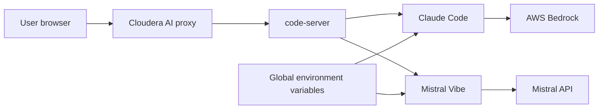

# re:Invent runtime: VS Code + Claude on Bedrock + Mistral Vibe

Custom ML runtime for **Cloudera AI Workbench** that launches **VS Code in the browser** via [code-server](https://github.com/coder/code-server), with both coding agents installed in the image:

- **[Claude Code](https://code.claude.com/docs/en/vs-code)** (CLI and VS Code extension) calling **[Amazon Bedrock](https://aws.amazon.com/bedrock/)** directly. Each model-picker row is a separate Bedrock inference profile.
- **[Mistral Vibe](https://docs.mistral.ai/vibe/code/overview)** (CLI and VS Code extension), default model **Codestral**

Credentials are **not** baked into the image. Set them once as **global environment variables** on the Cloudera AI workbench. Every session using this runtime picks them up at start and writes Vibe and Claude config before the editor opens.

```
VS Code (browser)
  ├─ Claude Code extension / `claude`  →  AWS Bedrock (one model id per picker row)
  └─ Mistral Vibe extension / `vibe`   →  MISTRAL_API_URL (Codestral by default)
```

## Global environment variables

Set these in **Site Administration** (global / site environment), not in the image. Restart sessions after you change them.

| Variable | Required | What to put |
| --- | --- | --- |
| `AWS_ACCESS_KEY_ID` | Yes, for Claude | Long-lived IAM access key with `bedrock:InvokeModel` |
| `AWS_SECRET_ACCESS_KEY` | Yes, for Claude | Matching secret key |
| `AWS_REGION` | Yes, for Claude | Bedrock region, for example `us-east-1` |
| `BEDROCK_MODEL` | No | Optional override for the Sonnet picker row. When unset, Sonnet is `us.anthropic.claude-sonnet-4-6` |
| `MISTRAL_API_KEY` | Yes, for Vibe | Mistral API key |
| `MISTRAL_API_URL` | Yes, when using a custom endpoint | Mistral API address, for example `https://api.mistral.ai/v1` |
| `MISTRAL_MODEL` | No | Vibe model alias. Image default is **`codestral`** |

Optional:

| Variable | Purpose |
| --- | --- |
| `MISTRAL_CONSOLE_URL` | Console host for hosted Cloudera Mistral stacks (`browser_auth_base_url`) |
| `BEDROCK_SONNET_MODEL` | Sonnet row. Default `us.anthropic.claude-sonnet-4-6`. `BEDROCK_MODEL` is the same override when this is unset |
| `BEDROCK_OPUS_MODEL` | Opus row. Default `us.anthropic.claude-opus-4-6-v1` |
| `BEDROCK_HAIKU_MODEL` | Haiku row. Default `us.anthropic.claude-haiku-4-5-20251001-v1:0` |
| `BEDROCK_FABLE_MODEL` | Fable row. Default `global.anthropic.claude-fable-5-2` |

`MISTRAL_API_ADDRESS` is accepted as an alias of `MISTRAL_API_URL`. `MISTRAL_VIBE_ACTIVE_MODEL` is accepted as an alias of `MISTRAL_MODEL`. When `MISTRAL_MODEL` is set, it overrides the image default.

Aliases the runtime knows for `MISTRAL_MODEL`:

| `MISTRAL_MODEL` | API model id |
| --- | --- |
| `codestral` (default) | `codestral-latest` |
| `codestral-2508` | `codestral-2508` |
| `mistral-small-4` | `mistral-small-latest` |
| `mistral-large-4` | `mistral-large-latest` |
| `glm-5-3` | `zai-glm-5-3` |

Any other value is written through as both the alias and the API id. List what your endpoint actually serves with:

```bash
curl -sS "${MISTRAL_API_URL:-https://api.mistral.ai/v1}/models" \
  -H "Authorization: Bearer ${MISTRAL_API_KEY}" | jq -r '.data[].id' | sort
```

Enable each of those models in the Bedrock console for the account that owns the access key. A picker row calls that exact inference profile. Outside a US Region, set the matching `eu.`, `jp.`, `apac.`, or `global.` profile id for that row.

## What starts with the session

You do not run a sync command. Starting the session reads the global environment and applies it before VS Code opens.

The editor entrypoint (`ml-runtime-editor`):

1. Writes `~/.vibe/config.toml` and `~/.vibe/.env` from `MISTRAL_API_KEY`, `MISTRAL_API_URL`, and `MISTRAL_MODEL`.
2. When the AWS key pair and region are present, writes `~/.claude/settings.json` with `CLAUDE_CODE_USE_BEDROCK=1` and one Bedrock inference profile per picker row (Sonnet, Opus, Haiku, Fable). Claude Code signs those calls with the IAM key pair. The extension login prompt is disabled. Any previous LiteLLM gateway URL is removed from the settings file.
3. Starts code-server with Claude Code and Mistral Vibe already installed and enabled. The extensions live in `/opt/code-server`, outside the project mount at `/home/cdsw`, so they are present on every session.

A new integrated terminal reads the same environment again and refreshes those settings. Changing a global variable applies on the next session start.

Open **Claude Code** and **Mistral Vibe** from the activity bar. In the terminal, `claude` and `vibe` are on `PATH`.

| Command | Description |
| --- | --- |
| `claude` | Open Claude Code in the terminal |
| `claude-status` | Show the four Bedrock model ids and the Vibe model |
| `vibe` | Open the Mistral Vibe CLI (same `~/.vibe` config as the extension) |

Chat history for Vibe is under `/home/cdsw/.vibe/logs/session/` on the project filesystem.

## Build and register

The runtime catalog version is **1.2.1**. It is separate from the code-server release and from the Claude and Mistral extension releases. To publish the next build, bump `ML_RUNTIME_MAINTENANCE_VERSION` in the Dockerfile (`1` → `2` produces `1.2.2`) and tag the image with `ML_RUNTIME_FULL_VERSION`.

```bash
docker build --platform linux/amd64 --pull --rm \
  -f Dockerfile \
  -t <your-registry>/reinvent-vsc-claude-vibe:1.2.1 .

docker push <your-registry>/reinvent-vsc-claude-vibe:1.2.1
```

**Admin → Runtime Catalog → Add Runtime**, using the version-tagged image. The image sets `ML_RUNTIME_EDITOR=VsCode`.

Base image: `ml-runtime-pbj-workbench-python3.13-standard:2026.08.1-b5`. Change the `FROM` line if the cluster uses a different PBJ tag.

| Catalog field | 1.2.1 |
| --- | --- |
| `ML_RUNTIME_SHORT_VERSION` | `1.2` |
| `ML_RUNTIME_MAINTENANCE_VERSION` | `1` |
| `ML_RUNTIME_FULL_VERSION` | `1.2.1` |

## Architecture

| Component | Role |
| --- | --- |
| **Cloudera AI Workbench** | Sessions, editor proxy, global environment variables |
| **code-server** | VS Code in the browser on `127.0.0.1:8090` |
| **Claude Code extension + CLI** | Agentic coding. Each picker row calls its own Bedrock model |
| **Mistral Vibe extension + CLI** | Agentic coding against the Mistral API (Codestral by default) |
| **PBJ Workbench (Python 3.13)** | Base ML runtime |



## Repository structure

| Path | Description |
| --- | --- |
| `Dockerfile` | PBJ base, code-server, Claude Code, Vibe CLI, both extensions |
| `config/code-server-settings.json` | Preinstalled extension list; Claude login prompt disabled |
| `scripts/vscode-launch.sh` | Editor entrypoint: configure both agents, then start code-server |
| `scripts/configure-bedrock-from-env.sh` | Write Claude Bedrock settings from global env |
| `scripts/configure-vibe-from-env.sh` | Write `~/.vibe` config from global env |
| `scripts/install-vscode-extension.sh` | Build-time Marketplace VSIX install |
| `scripts/install-mistral-vibe-cli.sh` | Build-time `pip install mistral-vibe` |
| `scripts/bedrock-runtime-startup.sh` | Terminal helpers: `claude` and the status banner |
| `scripts/lib/bedrock-common.sh` | Maps the Claude Code picker to Bedrock model ids |

## Prerequisites

- Cloudera AI Workbench with permission to add **custom runtimes** and set **global environment variables**
- Docker on **linux/amd64** with pull access to `docker.repository.cloudera.com`
- A registry the cluster can pull from
- An AWS account with Bedrock model access for the Sonnet, Opus, Haiku, and Fable inference profiles below. Fable 5.2 also requires the account data-retention mode `aws_review`
- A Mistral API key for the Vibe endpoint in `MISTRAL_API_URL`

Workbench sessions do not need a GPU. Inference runs in AWS Bedrock and on the Mistral API.

## Troubleshooting

| Issue | Fix |
| --- | --- |
| Claude banner says Bedrock env is missing | Set the global AWS key pair and `AWS_REGION`, then restart the session |
| `AccessDeniedException` from Bedrock | IAM needs `bedrock:InvokeModel` and `bedrock:InvokeModelWithResponseStream` on each inference profile. Enable that model in the Bedrock console |
| HTTP 403 from Bedrock | The access key cannot invoke the selected model. Enable that model, or set the matching `BEDROCK_*_MODEL` variable, then restart the session |
| One picker row fails and the others work | That row's model is not enabled for the key, or the profile prefix does not match the Region. Set `BEDROCK_SONNET_MODEL`, `BEDROCK_OPUS_MODEL`, `BEDROCK_HAIKU_MODEL`, or `BEDROCK_FABLE_MODEL` to the profile id from the model card |
| Vibe asks for a key | Confirm `MISTRAL_API_KEY` is set globally and restart the session |
| Vibe uses the wrong model | Set `MISTRAL_MODEL` (for example `codestral`) and restart, or run `vibe` and type `/model` |
| Extension missing from the activity bar | Reload the window. Both extensions are installed at image build; a registry image built before this Dockerfile will not have them |
| Auto mode says a model is temporarily unavailable and blocks Bash | Rebuild this image so Claude Code calls Bedrock directly. On Bedrock, auto mode's safety check runs on the selected model. Sonnet 4.6, Opus 4.6, and Haiku 4.5 are selectable, and Fable 5.2 is the row built for that check. Switch the picker to Fable when auto mode cannot classify with the older model |
| Claude Code or Mistral Vibe missing from the activity bar | Rebuild this image. Both extensions are enabled from `/opt/code-server/extensions` when the editor starts |

## Documentation

- [Claude Code in VS Code](https://code.claude.com/docs/en/vs-code)
- [Claude Code on Amazon Bedrock](https://code.claude.com/docs/en/amazon-bedrock)
- [Bedrock model IDs](https://docs.aws.amazon.com/bedrock/latest/userguide/model-ids.html)
- [Mistral Vibe overview](https://docs.mistral.ai/vibe/code/overview)
- [Mistral Vibe VS Code extension](https://docs.mistral.ai/vibe/code/vs-code-extension/install-authenticate)
- [Cloudera community ML runtimes — VS Code](https://github.com/cloudera/community-ml-runtimes/tree/main/vscode)
