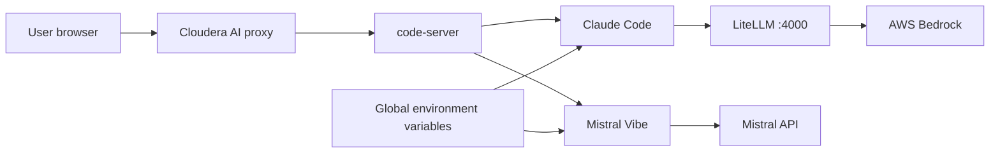

# re:Invent runtime: VS Code + Claude on Bedrock + Mistral Vibe

Custom ML runtime for **Cloudera AI Workbench** that launches **VS Code in the browser** via [code-server](https://github.com/coder/code-server), with both coding agents installed in the image:

- **[Claude Code](https://code.claude.com/docs/en/vs-code)** (CLI and VS Code extension) routed to **[Amazon Bedrock](https://aws.amazon.com/bedrock/)** through a local LiteLLM proxy
- **[Mistral Vibe](https://docs.mistral.ai/vibe/code/overview)** (CLI and VS Code extension), default model **Codestral**

Credentials are **not** baked into the image. Set them once as **global environment variables** on the Cloudera AI workbench. Every session using this runtime picks them up at start, writes Vibe and Claude config, and starts the Bedrock proxy before the editor opens.

```
VS Code (browser)
  ├─ Claude Code extension / `claude`  →  LiteLLM :4000  →  AWS Bedrock
  └─ Mistral Vibe extension / `vibe`   →  MISTRAL_API_URL (Codestral by default)
```

## Global environment variables

Set these in **Site Administration** (global / site environment), not in the image. Restart sessions after you change them.

| Variable | Required | What to put |
| --- | --- | --- |
| `AWS_ACCESS_KEY_ID` | Yes, for Claude | Long-lived IAM access key with `bedrock:InvokeModel` |
| `AWS_SECRET_ACCESS_KEY` | Yes, for Claude | Matching secret key |
| `AWS_REGION` | Yes, for Claude | Bedrock region, for example `us-east-1` |
| `BEDROCK_MODEL` | Yes, for Claude | Bedrock model id, for example `us.anthropic.claude-sonnet-5-5` |
| `MISTRAL_API_KEY` | Yes, for Vibe | Mistral API key |
| `MISTRAL_API_URL` | Yes, when using a custom endpoint | Mistral API address, for example `https://api.mistral.ai/v1` |
| `MISTRAL_MODEL` | No | Vibe model alias. Image default is **`codestral`** |

Optional:

| Variable | Purpose |
| --- | --- |
| `MISTRAL_CONSOLE_URL` | Console host for hosted Cloudera Mistral stacks (`browser_auth_base_url`) |
| `BEDROCK_LITELLM_PORT` | Local LiteLLM port (default `4000`) |

`MISTRAL_API_ADDRESS` is accepted as an alias of `MISTRAL_API_URL`. `MISTRAL_VIBE_ACTIVE_MODEL` is accepted as an alias of `MISTRAL_MODEL`. When `MISTRAL_MODEL` is set, it overrides the image default.

Aliases the runtime knows for `MISTRAL_MODEL`:

| `MISTRAL_MODEL` | API model id |
| --- | --- |
| `codestral` (default) | `codestral-latest` |
| `codestral-2508` | `codestral-2508` |
| `mistral-small-4` | `mistral-small-latest` |
| `mistral-large-4` | `mistral-large-latest` |
| `glm-5-3` | `zai-glm-5-3` |

Any other value is written through as both the alias and the API id. List what your endpoint actually serves with:

```bash
curl -sS "${MISTRAL_API_URL:-https://api.mistral.ai/v1}/models" \
  -H "Authorization: Bearer ${MISTRAL_API_KEY}" | jq -r '.data[].id' | sort
```

If `BEDROCK_MODEL` does not start with `bedrock/`, the runtime prefixes it as `bedrock/invoke/<model>`.

## What starts with the session

You do not run a sync command. Starting the session reads the global environment and applies it before VS Code opens.

The editor entrypoint (`ml-runtime-editor`):

1. Writes `~/.vibe/config.toml` and `~/.vibe/.env` from `MISTRAL_API_KEY`, `MISTRAL_API_URL`, and `MISTRAL_MODEL`.
2. When the AWS key pair, region, and `BEDROCK_MODEL` are present, starts LiteLLM on `127.0.0.1:4000` using those long-lived keys and writes `~/.claude/settings.json` so the Claude Code extension and the CLI share that gateway. The extension login prompt is disabled.
3. Starts code-server. Both extensions are already installed:
   - `anthropic.claude-code`
   - `mistralai.mistral-vibe-code`

A new integrated terminal reads the same environment again. If the gateway is already running for those values, it leaves it alone. If the proxy is down, the terminal starts it. Changing a global variable applies on the next session start.

Open **Claude Code** and **Mistral Vibe** from the activity bar. In the terminal, `claude` and `vibe` are on `PATH`.

| Command | Description |
| --- | --- |
| `claude` | Open Claude Code in the terminal |
| `claude-status` | Show Bedrock and Vibe env |
| `claude-logs` | Tail the LiteLLM log |
| `vibe` | Open the Mistral Vibe CLI (same `~/.vibe` config as the extension) |

Chat history for Vibe is under `/home/cdsw/.vibe/logs/session/` on the project filesystem.

## Build and register

The runtime catalog version starts at **1.1.1**. It is separate from the code-server release and from the Claude and Mistral extension releases. To publish the next build, bump `ML_RUNTIME_MAINTENANCE_VERSION` in the Dockerfile (`1` → `2` produces `1.1.2`) and tag the image with `ML_RUNTIME_FULL_VERSION`.

```bash
docker build --platform linux/amd64 --pull --rm \
  -f Dockerfile \
  -t <your-registry>/reinvent-vsc-claude-vibe:1.1.1 .

docker push <your-registry>/reinvent-vsc-claude-vibe:1.1.1
```

**Admin → Runtime Catalog → Add Runtime**, using the version-tagged image. The image sets `ML_RUNTIME_EDITOR=VsCode`.

Base image: `ml-runtime-pbj-workbench-python3.13-standard:2026.08.1-b5`. Change the `FROM` line if the cluster uses a different PBJ tag.

| Catalog field | 1.1.1 |
| --- | --- |
| `ML_RUNTIME_SHORT_VERSION` | `1.1` |
| `ML_RUNTIME_MAINTENANCE_VERSION` | `1` |
| `ML_RUNTIME_FULL_VERSION` | `1.1.1` |

## Architecture

| Component | Role |
| --- | --- |
| **Cloudera AI Workbench** | Sessions, editor proxy, global environment variables |
| **code-server** | VS Code in the browser on `127.0.0.1:8090` |
| **Claude Code extension + CLI** | Agentic coding against Bedrock |
| **LiteLLM** | Local Anthropic Messages API → Bedrock Invoke API |
| **Mistral Vibe extension + CLI** | Agentic coding against the Mistral API (Codestral by default) |
| **PBJ Workbench (Python 3.13)** | Base ML runtime |



## Repository structure

| Path | Description |
| --- | --- |
| `Dockerfile` | PBJ base, code-server, Claude Code, LiteLLM, Vibe CLI, both extensions |
| `config/code-server-settings.json` | Preinstalled extension list; Claude login prompt disabled |
| `scripts/vscode-launch.sh` | Editor entrypoint: configure both agents, then start code-server |
| `scripts/configure-bedrock-from-env.sh` | Start LiteLLM and write Claude settings from global env |
| `scripts/configure-vibe-from-env.sh` | Write `~/.vibe` config from global env |
| `scripts/install-vscode-extension.sh` | Build-time Marketplace VSIX install |
| `scripts/install-mistral-vibe-cli.sh` | Build-time `pip install mistral-vibe` |
| `scripts/bedrock-runtime-startup.sh` | Terminal helpers: `claude`, status banner, re-apply env if the gateway is down |
| `scripts/lib/bedrock-common.sh` | LiteLLM and Bedrock token helpers |
| `requirements-litellm.txt` | Pinned LiteLLM proxy dependencies |

## Prerequisites

- Cloudera AI Workbench with permission to add **custom runtimes** and set **global environment variables**
- Docker on **linux/amd64** with pull access to `docker.repository.cloudera.com`
- A registry the cluster can pull from
- An AWS account with Bedrock model access for `BEDROCK_MODEL`
- A Mistral API key for the Vibe endpoint in `MISTRAL_API_URL`

Workbench sessions do not need a GPU. Inference runs in AWS Bedrock and on the Mistral API.

## Troubleshooting

| Issue | Fix |
| --- | --- |
| Claude banner says Bedrock env is missing | Set the global AWS and `BEDROCK_MODEL` variables, then restart the session |
| `AccessDeniedException` from Bedrock | IAM needs `bedrock:InvokeModel` (and `InvokeModelWithResponseStream`). Enable the model in the Bedrock console |
| HTTP 403 from Bedrock | The access key cannot invoke `BEDROCK_MODEL`. Fix the global key pair or model access, then restart the session |
| Vibe asks for a key | Confirm `MISTRAL_API_KEY` is set globally and restart the session |
| Vibe uses the wrong model | Set `MISTRAL_MODEL` (for example `codestral`) and restart, or run `vibe` and type `/model` |
| Extension missing from the activity bar | Reload the window. Both extensions are installed at image build; a registry image built before this Dockerfile will not have them |
| Proxy will not start | `claude-logs` |

## Documentation

- [Claude Code in VS Code](https://code.claude.com/docs/en/vs-code)
- [Claude Code on Amazon Bedrock](https://code.claude.com/docs/en/amazon-bedrock)
- [Bedrock model IDs](https://docs.aws.amazon.com/bedrock/latest/userguide/model-ids.html)
- [Mistral Vibe overview](https://docs.mistral.ai/vibe/code/overview)
- [Mistral Vibe VS Code extension](https://docs.mistral.ai/vibe/code/vs-code-extension/install-authenticate)
- [Cloudera community ML runtimes — VS Code](https://github.com/cloudera/community-ml-runtimes/tree/main/vscode)
